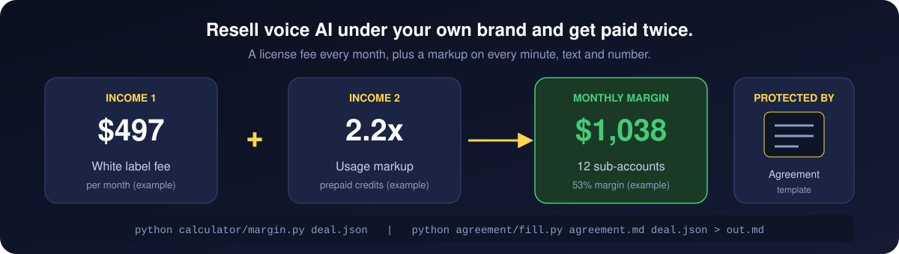

# Voice AI White Label Kit

An agreement template and margin calculator for agencies that resell voice AI under their own brand and earn from both a license fee and a markup on usage credits.



The kit has three parts:

- **Agreement template:** a short white label services agreement with a rate card. Fill it from a JSON file.
- **Margin calculator:** a browser page and a CLI. Enter your costs and prices, get monthly margin and a 12 month projection.
- **Pricing guide:** how to set a markup, why prepaid wallets win, and what to watch for in any agreement.

```bash
python agreement/fill.py agreement/white-label-voice-ai-agreement.md examples/deal.example.json > my-agreement.md
python calculator/margin.py examples/margin.example.json
```

> **Not legal advice.** The agreement is a template only. Have a lawyer in your state review it before you use it.

---

## Why this exists

Agencies that resell voice AI on GoHighLevel, LeadConnector or a similar platform tend to make money one way: a monthly fee. The usage side is where the margin is, and it is also where agencies lose money. Calls get billed after the fact, a customer disputes the charge, and the agency has already paid the vendor.

This kit puts both income lines in one agreement. The monthly fee covers the license. A prepaid wallet covers usage, so you collect before the cost happens. The calculator shows what that adds up to before you quote a customer.

---

## How it works

### 1. The agreement

`agreement/white-label-voice-ai-agreement.md` is about two pages plus a rate card. Every variable value is a `{{placeholder}}`.

| Section | What it covers |
|---|---|
| Key terms | One table with the deal at a glance |
| 1. Parties and license | What is licensed, setup scope, launch timeline |
| 2. Fees | Launch fee, platform fee, extra sub-accounts, add-ons |
| 3. Usage credits | Prepaid wallet, minimum load, auto-reload, pause at zero, rate changes |
| 4. Payment, support, suspension | Autopay, disputes, chargebacks, past due pause, support targets |
| 5. White label rights | Non-circumvention for 12 months, liquidated damages |
| 6. Compliance and data | TCPA, DNC, A2P 10DLC, recording consent, indemnity |
| 7. Term and exit | Minimum term, exit fee, cure period, data export, number transfer |
| 8. Legal basics | IP, liability cap, changes in writing, governing law |
| Schedule A | Rate card with example prices in [brackets] |

### 2. Filling it in

Copy `examples/deal.example.json`, change the values, and run:

```bash
python agreement/fill.py agreement/white-label-voice-ai-agreement.md deal.json > out.md
```

If any placeholder has no value, the script prints the missing names and exits with an error. Nothing is written to a half-filled file by accident. Keys that start with an underscore (like `_note`) are ignored.

Use bracketed placeholders such as `[Provider Name]`, `[Client Name]` and `[State]` while drafting. Replace them with the real values in your deal file.

### 3. The calculator

Open `calculator/margin.html` in any browser. It is one file with no external scripts and works offline. It follows your light or dark system setting. The default numbers are examples and are labeled that way.

Inputs:

| Input | Meaning |
|---|---|
| Sub-accounts live and included | How many you serve, and how many the platform fee covers |
| Platform fee, extra sub-account fee | What you charge |
| Your platform cost | What you pay for the underlying platform each month |
| Minutes, cost per minute, price per minute | Voice usage |
| Phone numbers, cost, price | Number rental |
| SMS segments, cost, price | Texting |
| Monthly growth | Used for the 12 month projection |

Outputs: monthly revenue, cost, margin, margin percentage, markup multiple (revenue divided by cost), and a 12 month table.

The same math runs from the command line:

```bash
python calculator/margin.py examples/margin.example.json
```

Growth applies to sub-accounts and to usage together, so the projection stays in proportion.

---

## Usage

```bash
git clone https://github.com/yousiful/voice-ai-whitelabel-kit.git
cd voice-ai-whitelabel-kit
python agreement/fill.py agreement/white-label-voice-ai-agreement.md examples/deal.example.json
```

Python 3.9 or later. No dependencies.

Read `docs/pricing-guide.md` before you set your prices.

---

## Running the tests

```bash
python -m pytest tests/
# or without pytest:
python tests/test_margin.py
```

The tests cover the margin math, the placeholder filler and the example deal. No network calls.

---

## Want a white label voice AI platform without building it?

KenjiAI runs done-for-you AI call centers and white label setups for agencies.

- **Sign up:** [freedom.kenjiai.com/finishhere](https://freedom.kenjiai.com/finishhere?utm_source=github&utm_medium=readme&utm_campaign=voice-ai-whitelabel-kit)
- **Book a call:** [go.mediatraffics.com/leads](https://go.mediatraffics.com/leads?utm_source=github&utm_medium=readme&utm_campaign=voice-ai-whitelabel-kit)
- **Learn more:** [kenjiai.com](https://kenjiai.com/?utm_source=github&utm_medium=readme&utm_campaign=voice-ai-whitelabel-kit)

---

## More free tools from us

- **[Kenji Clip Engine](https://github.com/yousiful/kenji-clip-engine)**: turn any YouTube video into captioned vertical clips and post them everywhere through Kenji.
- **[No-Website Finder](https://github.com/yousiful/no-website-finder)**: find local businesses on Google Maps with no website and push them into Kenji to pitch.
- **[Meta Ads Kill Switch](https://github.com/yousiful/meta-ads-kill-switch)**: auto-pause any ad that spends past your limit with zero results.
- **[Reel Editing Toolkit](https://github.com/yousiful/reel-editing-toolkit)**: our full animated reel pipeline.
- **[GHL Client Onboarding](https://github.com/yousiful/ghl-client-onboarding)**: intake form, onboarding checklist and a read-only GHL sub-account audit.
- **[Options Trade Toolkit](https://github.com/yousiful/options-trade-toolkit)**: options pricing, greeks, position sizing and a trade journal.
- **[AI Voice Agent Playbook](https://github.com/yousiful/ai-voice-agent-playbook)**: prompt templates and a linter for AI setter, closer and receptionist agents.
- **[GHL Failed Payment Recovery](https://github.com/yousiful/ghl-failed-payment-recovery)**: win back failed subscription payments in GoHighLevel.

## Feedback and bugs

Something broke, or you want a feature? **[Open an issue](https://github.com/yousiful/voice-ai-whitelabel-kit/issues/new/choose)**. We read every one and fix what we can. If this saved you time, a star helps other people find it.

MIT License.
